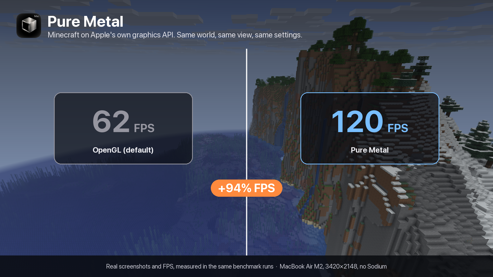

# Pure Metal

A native Metal renderer for Minecraft on Apple Silicon Macs. Same visuals as vanilla, rendered through Apple's Metal API instead of OpenGL. Works with Sodium.

- Terrain LOD for extra FPS at long render distances
- Optional Render Scale with temporal upscaling
- Experimental Metal 4 mode (macOS 26+)
- A Pure Metal line on the F3 screen for bug reports



## Requirements

- macOS 14 or newer on Apple Silicon (tested on M2). The optional Metal 4 mode needs macOS 26.
- Minecraft 26.3 with Fabric Loader 0.19+
- Java 25
- Sodium 0.9.2 (optional)

Iris and other shader mods are not supported.

## Known limitations

- Experimental. Tested on an Apple M2 only; other Macs should work but are untested.
- Metal 4 mode is optional and slower or less stable than Metal 3 for now.
- Iris and other shader mods are not supported.
- Pure Metal is an independent project and is not affiliated with Mojang, Microsoft or Apple.

## Install

Download the jar from the releases page and put it in your `mods` folder. Leave Graphics API on Default.

## Build

```
./gradlew build
```

Needs Xcode 26 or newer, or its command line tools (the Objective-C bridge is built with the system `clang` against the macOS 26 SDK; the result still runs on macOS 14+) and a Java 25 toolchain. The jar ends up in `build/libs`.

## Benchmarking

`tools/bench.py` runs one dev client per graphics API, one at a time (`default` is Metal, the others are `vulkan` and `opengl`), and prints the average FPS and the 98th and 99.5th percentile frame times for each. It needs a `run/` world named "New World" and the same toolchain as the build:

```
python3 -I tools/bench.py <tag> default opengl
```

The game window must stay focused and in the world while it runs. Useful environment variables: `BENCH_SECONDS` and `BENCH_WARMUP` (measure and warm-up length, default 25 and 10 s), `BENCH_REPEAT` (runs per API; the median is printed), `BENCH_WALK` (fly forward) and `NO_SODIUM`. Your own vsync, fullscreen, pause-on-focus-loss and graphics API options in `run/options.txt` are restored afterwards. Results depend heavily on the Mac, the world and the render distance, so compare runs on the same machine only.

## Docs

- [Design notes](docs/DESIGN.md)
- [Changelog](CHANGELOG.md)

## Issues

Bug reports go to the issue tracker. Include the Pure Metal line from F3 and `latest.log`.

## License

Apache License 2.0, see [LICENSE](LICENSE).
